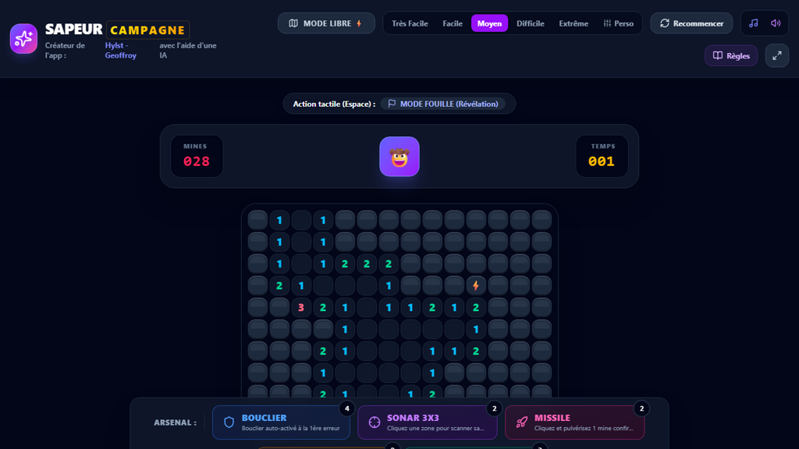

# Sapeur

**24 missions de déminage, un arsenal tactique à débloquer.**

Joue ici : [games.hylst.fr/sapeur/](https://games.hylst.fr/sapeur/)



## Comment on joue

Le démineur classique : clic gauche pour révéler, clic droit pour planter un drapeau, un
chiffre indique le nombre de mines dans les 8 cases voisines. Cliquer sur un chiffre déjà
révélé, une fois le bon nombre de drapeaux posés autour, révèle tous ses voisins d'un coup
(clic groupé). Le premier clic est toujours sûr.

Deux façons de jouer :
- **Mode Expédition** — une campagne de 24 missions avec objectifs, chapitres à débloquer et
  récompenses en XP et en outils tactiques.
- **Mode Libre** — cinq difficultés prédéfinies, ou une grille entièrement personnalisée
  (taille et nombre de mines).

## Contrôles

| Action | Effet |
|--------|-------|
| Clic gauche | Révéler une cellule |
| Clic droit | Poser / retirer un drapeau |
| Clic sur un chiffre révélé | Clic groupé : révèle les voisins si les drapeaux correspondent |
| Espace | Bascule le mode tactile Fouille / Drapeau |

## L'arsenal tactique

| Outil | Effet |
|-------|-------|
| 🛡️ Bouclier | Absorbe automatiquement une explosion (passif) |
| 🎯 Sonar 3×3 | Scanne une zone et marque les mines détectées sans les faire exploser |
| 🚀 Missile | Pulvérise une mine confirmée en un clic |
| ⏱️ Stase 15s | Gèle le chronomètre pendant 15 secondes |
| ✅ Sonde Sûre | Révèle instantanément 3 cases sûres au hasard |

Des caisses de ravitaillement cachées sur la carte donnent des outils supplémentaires en
cours de partie.

## Ce qu'il y a dedans

- Campagne de 24 missions réparties en 4 chapitres, avec objectifs et récompenses
- Mode libre avec 5 difficultés et un mode personnalisé
- Système d'XP et de progression sauvegardé en local
- Confettis et fanfare à la victoire
- Musique d'ambiance générative et effets sonores synthétisés (Web Audio)

## L'arborescence

```
sapeur-game-development/
├── index.html              # template + bloc SEO
├── vite.config.ts          # base '/sapeur/' + singlefile
├── public/
│   ├── favicon.png
│   ├── og-image.png / og-image.webp
│   └── icon.webp            # carte du menu, 128x128
└── src/
    ├── main.tsx
    ├── App.tsx               # etat global, logique de jeu, navigation
    ├── types/game.ts
    ├── data/levels.ts         # les 24 missions de la campagne
    ├── services/audio.ts      # synthese Web Audio
    └── components/
        ├── Header.tsx
        ├── BoardView.tsx       # plateau + HUD
        ├── BonusToolbar.tsx    # arsenal
        ├── CampaignView.tsx    # ecran de selection de mission
        ├── OnboardingModal.tsx
        ├── RulesModal.tsx
        └── CustomGameModal.tsx
```

## Dev

```bash
npm install
npm run dev       # http://localhost:5173/sapeur/
npm run build     # dist/index.html, un seul fichier
npm run preview
```

## Stack

React 19, TypeScript 5.9 (strict), Tailwind CSS 4, Vite 7, vite-plugin-singlefile,
framer-motion, canvas-confetti, lucide-react.

Zéro backend : le jeu tient dans un seul fichier HTML et tourne hors ligne.

## Licence

MIT, Geoffroy Streit (Hylst)
